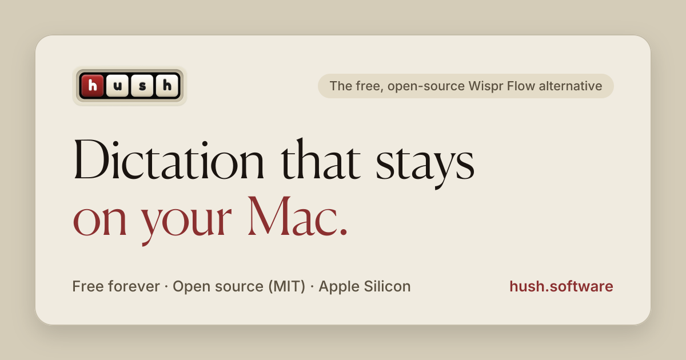

# Hush

<p align="center">
  <a href="https://www.hush.software"></a>
</p>

<p align="center">
  <a href="https://www.hush.software/download"><strong>Download for Mac</strong></a> ·
  <a href="https://www.hush.software">Website</a> ·
  <a href="https://www.hush.software/compare">Compare</a> ·
  <a href="https://github.com/DeepanshuPal/hush-downloads/releases">Releases</a>
</p>

<p align="center">
  <a href="https://github.com/DeepanshuPal/hush-downloads/releases/latest"></a>
  <a href="https://github.com/DeepanshuPal/hush-downloads/releases"></a>
  
  <a href="LICENSE"></a>
  <a href="https://github.com/DeepanshuPal/hush/actions/workflows/ci.yml"></a>
</p>

**Free, private push-to-talk dictation for the Mac.** Hold a key, speak, let
go: your words are typed into whatever app you're using. Speech recognition runs
entirely on your Mac. No account, no subscription, no word limits.

Hush is free and open source (MIT). It aims to be the best free alternative to
paid dictation apps like Wispr Flow.

## Features

- **Push to talk anywhere.** Hold <kbd>Fn</kbd> (or any shortcut you choose) to
  dictate into any text field. Tap (or double-tap) to keep recording
  hands-free, and press <kbd>Esc</kbd> to cancel.
- **Paste last transcript.** <kbd>Ctrl</kbd>+<kbd>Cmd</kbd>+<kbd>V</kbd> pastes
  your most recent dictation again; it's also in the menu bar.
- **On-device speech recognition.** Pick Fast (Parakeet V3), Live preview
  (Nemotron Streaming) or Most accurate (Granite Speech 4.1), or any of the
  other open models. They run locally with Metal acceleration; Hush downloads
  the model once and works offline from then on.
- **Live preview.** Streaming models show your words in the overlay as you speak.
- **AI clean-up (optional).** Fix punctuation, drop "um"s and self-corrections,
  and keep your custom words spelled right, using an AI provider you choose:
  Groq, OpenAI, Anthropic, OpenRouter, Apple Intelligence, or any
  OpenAI-compatible endpoint such as a local Ollama server. Bring your own key.
- **Styles per app.** Casual in Slack, professional in Mail, exact identifiers
  in your code editor, or no AI at all in a given app. Add any app you use.
- **Voice snippets.** Say "my email" and Hush types your address. Capitals and
  punctuation don't matter, and snippets work in the middle of a sentence.
- **Custom vocabulary** for names and jargon, and automatic filler-word removal
  that works without AI.
- **Your music pauses while you dictate** and resumes afterwards (or lower the
  volume, mute, or leave it alone).
- **History** of recent dictations, with audio, so you can copy or re-run them.
- **Native feel.** Menu bar app, light and dark mode, and an interface in 26
  languages.

## Install

1. Download the latest DMG from [hush.software](https://hush.software) or from
   [GitHub releases](https://github.com/DeepanshuPal/hush-downloads/releases).
   Builds are currently for Apple Silicon Macs (M1 and later).
2. Open the DMG and drag **Hush** to **Applications**.
3. Open Hush and follow the setup: grant Microphone and Accessibility access
   (Accessibility is what lets Hush type into other apps), then pick a speech
   model.

### "Hush can't be opened" / unidentified developer

Hush is not yet signed with an Apple Developer ID, so macOS Gatekeeper blocks
the first launch. To open it:

- **Right-click** (or Control-click) Hush in Applications and choose **Open**,
  then **Open** again in the dialog.
- On macOS 15 and later, if that doesn't offer an Open button: try to open Hush
  once, then go to **System Settings → Privacy & Security**, scroll down and
  click **Open Anyway**.

You only need to do this once per install. Signed and notarized builds are
planned.

## Privacy: what leaves your Mac

Hush has no telemetry, analytics, crash reporting or account. Only two things
ever go over the network:

1. **Model downloads.** When you choose a speech model, Hush downloads it from
   Hugging Face (or, for two older Whisper models, from the Hush downloads
   mirror on GitHub). Your audio is never uploaded.
2. **AI clean-up text, only if you turn it on.** When AI clean-up is enabled,
   the _text_ of each dictation (never the audio), your custom words, and the
   name of the app you're dictating into are sent to the provider you
   configured, using your API key. With AI clean-up off (the default), nothing
   you say leaves your Mac. Choose Apple Intelligence or a local endpoint to keep
   clean-up on-device too.

Your recordings, history and settings stay in
`~/Library/Application Support/com.hush.software/`. Release builds never write
transcript text to the log files.

## Troubleshooting

### Shortcuts stopped working (Secure Input)

When a password field is focused, or an app such as Terminal enables "Secure
Keyboard Entry", macOS blocks other apps from seeing key presses, so Hush's
shortcut can't fire. Hush shows a warning in its window and menu bar icon while
this is happening. Close the password prompt or turn off Secure Keyboard Entry
(Terminal → Secure Keyboard Entry) and the shortcut works again.

### Hush keeps asking for Accessibility after an update

Each Hush build has a new code identity until releases are Developer ID signed,
so macOS may keep the old Accessibility switch visibly on while no longer
honoring it. Remove Hush from **System Settings → Privacy & Security →
Accessibility** (select it and click **−**), then reopen Hush and grant access
again. See [BUILD.md](BUILD.md#troubleshooting) for a one-line Terminal fix.

### Text is pasted in the wrong place, or your old clipboard appears

Hush pastes through the clipboard and restores your previous clipboard
afterward. If an app reads the clipboard late, open the debug settings with
<kbd>Cmd</kbd>+<kbd>Shift</kbd>+<kbd>D</kbd> and increase the paste delay.

Something else? [Open an issue](https://github.com/DeepanshuPal/hush/issues).

## Build from source

You need macOS, Xcode Command Line Tools, Rust, Bun and CMake:

```bash
git clone https://github.com/DeepanshuPal/hush.git
cd hush
bun install
CMAKE_POLICY_VERSION_MINIMUM=3.5 bun run tauri dev
```

See [BUILD.md](BUILD.md) for release builds and details.

Hush is built with [Tauri](https://tauri.app) (Rust + React/TypeScript) and
[transcribe.cpp](https://github.com/handy-computer/transcribe.cpp) /
[ggml](https://github.com/ggml-org/ggml) for on-device speech recognition.

## Repository layout

| Folder       | What it is                                                                                         |
| ------------ | -------------------------------------------------------------------------------------------------- |
| `src/`       | The app's interface (React, TypeScript, Tailwind)                                                  |
| `src-tauri/` | The app's core (Rust, Tauri): audio, speech recognition, AI clean-up, paste                        |
| `website/`   | [hush.software](https://www.hush.software) (Next.js). See [`website/README.md`](website/README.md) |
| `docs/`      | Images and notes used by this README                                                               |

The app and the website share the same design language: cream surfaces, a burgundy accent and a serif display face.

## Contributing

Bug reports, translations and pull requests are welcome. Read
[CONTRIBUTING.md](CONTRIBUTING.md) to get started, and
[CONTRIBUTING_TRANSLATIONS.md](CONTRIBUTING_TRANSLATIONS.md) to help with a
language.

Bugs: [issues](https://github.com/DeepanshuPal/hush/issues). Questions and ideas: [discussions](https://github.com/DeepanshuPal/hush/discussions). Security problems: see [SECURITY.md](SECURITY.md). Everyone taking part follows the [code of conduct](CODE_OF_CONDUCT.md).

## License

Hush is released under the [MIT License](LICENSE). Bundled fonts and the speech
models Hush can download have their own licenses; see
[THIRD_PARTY_NOTICES.md](THIRD_PARTY_NOTICES.md).
